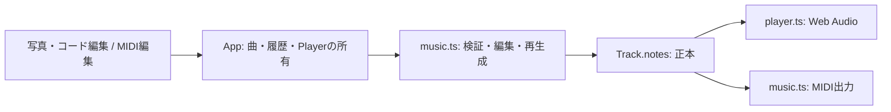

# アーキテクチャ・データ契約

## 現在の構成（実装済み）

React + TypeScript + Viteによるブラウザアプリ。Cloudflare Workers Static Assetsでdistを配信する設定を持つ。公開は未実施で、API用Worker・AI接続・DBバインディングは存在しない。
写真はObject URLでプレビューし、外部へ送信しない。曲・履歴・写真はメモリ内で保持し、再読み込みで失われる。

| モジュール | 責務・依存境界 |
| --- | --- |
| src/main.tsx | 画面遷移、写真、共有EditorState、再生成確認、Player、ダウンロード。音楽計算はmusic.tsに委譲 |
| src/music.ts | 型、設定・音符検証、初期生成、不変な編集、Undo、MIDIエンコード。React・DOM・ネットワークに依存しない |
| src/player.ts | 検証済みTrackの演奏と停止。music.tsを使い、UIやMIDI画面を参照しない |
| src/midi/ | propsとコールバック経由の音符編集。一時ドラフト・選択だけを画面内に保持 |
| src/style.css / src/midi/midi.css | 共通画面／MIDI専用の見た目 |
| tests/ | node:testによる音楽・編集・Playerの確認。Playerは音声APIの代替で検証 |

## 曲データと更新の契約

型・対応値の正本はsrc/music.ts。Songはbpm・pattern・barsからなる生成設定、TrackはSongにnotesを加えた編集可能な曲、Noteはpitch・startBeat・durationBeats・velocityを持つ。現在は曲ID・revision・曲名・キー・AIの理由を型に持たない。

- notesFor(Song)は音符生成、createTrackは初期曲の生成に使う。その後はTrack.notesを正本にし、再生のたびに設定から計算し直さない。
- playbackNotesが曲設定と音符を検証し、PlayerとmidiFor(Track)が同じ音符を使う。midiFor(Song)は設定から生成する既存入口であり、編集画面はTrackを渡す。
- 入力範囲・重複判定はvalidateSong／validateNotesに集約する。同音高の時間重複は拒否し、異なる音高の和音・端点が接する音符・無音の曲は許可する。
- replaceNote／regenerateは元の配列を変更せず、全体検証に成功した結果を返す。コード変更は開始拍が対象小節にある音符を置換する。小節をまたぐ音符も開始小節に属する。パターン変更は全音符、テンポ変更は音符を保持する。
- 再生成は手編集を置換する範囲を表示して確認後にcommitする。残る音符との重複が起きた場合は拒否する。
- EditorStateはcurrentとhistory。commitは無変更で履歴を増やさず、undoは設定・音符をまとめて戻す。ドラッグ中はdraftだけを変更し、pointerupで確定、中断時は破棄する。
- UIの移動は開始拍を量子化しても元の長さを保つ。生成済みの長さを表示・移動だけで丸めない。

## 再生と出力

PlayerはWeb AudioのOscillatorとGainによる合成音を使い、外部の音源・音楽ライブラリには依存しない。位置表示はAudioContext.currentTimeを基準に計算する。開始はユーザー操作に限定し、停止・再再生・編集・画面遷移で前のContextを閉じる。resume待ちの古い演奏も予約しない。

MIDIはmusic.ts内でエンコードする。音符・テンポ・拍子・曲終端を含め、同時刻はNote Offを先に並べる。ファイルの出力成功と外部DAWでの読み込み確認は別の検証として扱う。

## MIDI編集画面の分離

他担当者との変更競合を減らすため、MIDI編集は `#/midi` の独立した画面に分離した。写真・コード編集は `#/`（初期URLはハッシュなしでも可）。ルーターの追加依存やサーバー設定変更を必要としないハッシュ遷移を使う。

- 今後のMIDI画面の詳細化は `src/midi/MidiEditorScreen.tsx`、`src/midi/PianoRoll.tsx`、`src/midi/midi.css` 内で進める。専用CSSのセレクターは `.midi-screen` 以下に限定する。
- `MidiEditorScreenProps` が画面境界。Track・再生位置・Undo可否と、編集/停止/再生/Undo/出力のコールバックを受け取る。画面内で別の曲・履歴・Playerを作らない。
- Appが曲・履歴・写真・Playerを保持するため、画面のアンマウントで編集内容は消えない。画面移動時は再生を止めて再生成確認を破棄する。音符選択など画面内の一時状態は戻った際に初期化する。
- 写真/AI/音色の担当者は既存画面と共有サービスを担当し、MIDI画面担当者は専用ディレクトリを中心に変更する。Track・Player・MIDI出力の契約を変更する場合は双方で調整する。

## AI接続の設計方針（未実装）

現在のモジュールを保ち、API処理をサーバー側に追加する。ブラウザは同一オリジンのAPIを呼び、Worker側で画像・指示を検証してAIを呼ぶ。AIのJSONはunknownとして構造・対応値・サイズを検証し、アプリ側で音符を組み立てる。既存のvalidateSongは型付きデータの値検証であり、未知のJSONの構造検証の代わりにはしない。

| API案 | 入力 | 応答の役割 |
| --- | --- | --- |
| POST /api/songs | 写真、任意の希望 | 検証済み生成設定、印象、理由 |
| POST /api/songs/edit | 現在のTrack、指示、編集版番号 | 基準版番号、変更点・理由、候補Track |

これはAPI案であり、型・送信形式・プロバイダーは接続時に確定する。タイムアウト・二重送信防止・利用回数制限を設け、失敗時も現在の曲を残す。画像の外部送信を操作前に説明し、初期版では永続保存しない。

AI編集では現在の曲と候補を別に保持する。曲の編集版番号とリクエスト識別子を導入し、直接編集・Undo・画像切替・後続依頼後の古い応答を適用させない。試聴はcurrentと履歴を書き換えず、適用でだけcommitする。初期生成は直接読み込み可能だが、既存の編集を置き換える場合は明示する。

## 保存の設計方針（未実装）

永続保存の追加は[DATABASE.md](DATABASE.md)に従う。保存する音楽データは生成設定だけでなく手編集後のTrack.notesを含む。ローカルの編集版番号、DBの更新revision、保存形式のschema_versionは役割を分ける。D1・R2の追加をMVP完成の前提にしない。

将来案の採用時には、契約・実装・設定を揃え、資料の更新は最小限とする。
