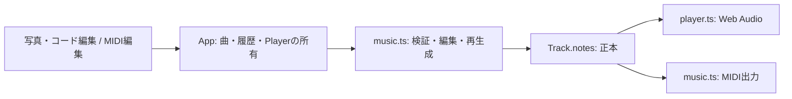

# アーキテクチャ・データ契約

## 現在の構成（実装済み）

React + TypeScript + Viteによるブラウザアプリ。Cloudflare Workers Static Assetsでdistを配信する設定を持つ。公開は未実施。src/worker.tsが画像分析APIとStatic Assetsを配信し、外部AI接続をサーバー側で行う。DBバインディングは存在しない。
写真はObject URLでプレビューし、利用者が分析を開始した場合にOpenAIへ送信する。曲・履歴・写真はメモリ内で保持し、再読み込みで失われる。

| モジュール | 責務・依存境界 |
| --- | --- |
| src/main.tsx | 画面遷移、写真、共有EditorState、再生成確認、Player、ダウンロード。音楽計算はmusic.tsに委譲 |
| src/music.ts | 型、設定・音符検証、初期生成、不変な編集、Undo、MIDIエンコード。React・DOM・ネットワークに依存しない |
| src/player.ts | 検証済みTrackの演奏と停止。music.tsを使い、UIやMIDI画面を参照しない |
| src/midi/ | propsとコールバック経由の音符編集。一時ドラフト・選択だけを画面内に保持 |
| src/style.css / src/midi/midi.css | 共通画面／MIDI専用の見た目 |
| tests/ | node:testによる音楽・編集・Playerの確認。Playerは音声APIの代替で検証 |

## 曲データと更新の契約

型・対応値の正本はsrc/music.ts。Songはbpm・pattern・barsからなる生成設定、TrackはSongにnotesと任意のinstrument（音色ID）・ミキサー設定・layersを加えた編集可能な曲、Noteはpitch・startBeat・durationBeats・velocityを持つ。現在は曲ID・revision・曲名・キー・AIの理由を型に持たない。

- notesFor(Song)は音符生成、createTrackは初期曲の生成に使う。その後はTrack.notesを正本にし、再生のたびに設定から計算し直さない。
- playbackNotesが曲設定と音符を検証し、PlayerとmidiFor(Track)が同じ音符を使う。midiFor(Song)は設定から生成する既存入口であり、編集画面はTrackを渡す。
- 入力範囲・重複判定はvalidateSong／validateNotesに集約する。同音高の時間重複は拒否し、異なる音高の和音・端点が接する音符・無音の曲は許可する。
- replaceNote／regenerateは元の配列を変更せず、全体検証に成功した結果を返す。コード変更は開始拍が対象小節にある音符を置換する。小節をまたぐ音符も開始小節に属する。パターン変更は全音符、テンポ変更は音符を保持する。
- 再生成は手編集を置換する範囲を表示して確認後にcommitする。残る音符との重複が起きた場合は拒否する。
- EditorStateはcurrentとhistory。commitは無変更で履歴を増やさず、undoは設定・音符をまとめて戻す。ドラッグ中はdraftだけを変更し、pointerupで確定、中断時は破棄する。
- UIの移動は開始拍を量子化しても元の長さを保つ。生成済みの長さを表示・移動だけで丸めない。

## 再生と出力

Playerはinstruments.tsの設定に応じてWeb AudioのBufferSource（サンプル音源）またはOscillatorとGain（内蔵シンセ）を使う。Appの初期曲・サンプル再読込はpianoを明示し、FluidR3の実音源を使う。旧データなど音色IDの未指定時は互換性のため内蔵エレクトリックピアノ。外部の音楽ライブラリには依存しない。位置表示はAudioContext.currentTimeを基準に計算する。開始はユーザー操作に限定し、停止・再再生・編集・画面遷移で前のContextを閉じる。resume待ちの古い演奏も予約しない。

MIDIはmusic.ts内でエンコードする。音符・テンポ・拍子・曲終端を含め、同時刻はNote Offを先に並べる。ファイルの出力成功と外部DAWでの読み込み確認は別の検証として扱う。

## MIDI編集画面の分離

他担当者との変更競合を減らすため、MIDI編集は `#/midi` の独立した画面に分離した。写真・コード編集は `#/`（初期URLはハッシュなしでも可）。ルーターの追加依存やサーバー設定変更を必要としないハッシュ遷移を使う。

- 今後のMIDI画面の詳細化は `src/midi/MidiEditorScreen.tsx`、`src/midi/PianoRoll.tsx`、`src/midi/midi.css` 内で進める。専用CSSのセレクターは `.midi-screen` 以下に限定する。
- `MidiEditorScreenProps` が画面境界。Track・再生位置・Undo可否と、編集/停止/再生/Undo/出力のコールバックを受け取る。画面内で別の曲・履歴・Playerを作らない。
- Appが曲・履歴・写真・Playerを保持するため、画面のアンマウントで編集内容は消えない。画面移動時は再生を止めて再生成確認を破棄する。音符選択など画面内の一時状態は戻った際に初期化する。
- 写真/AI/音色の担当者は既存画面と共有サービスを担当し、MIDI画面担当者は専用ディレクトリを中心に変更する。Track・Player・MIDI出力の契約を変更する場合は双方で調整する。

## AI接続の設計方針（未実装）

現在のモジュールを保ち、API処理をサーバー側に追加する。ブラウザは同一オリジンのAPIを呼び、Worker側で画像・指示を検証してAIを呼ぶ。AIのJSONはunknownとして構造・対応値・サイズを検証し、アプリ側で音符を組み立てる。既存のvalidateSongは型付きデータの値検証であり、未知のJSONの構造検証の代わりにはしない。

| API案 | 入力 | 応答の役割 |
| --- | --- | --- |
| POST /api/songs | 写真、任意の希望 | 検証済み生成設定、印象、理由 |
| POST /api/songs/edit | 現在のTrack、指示、編集版番号 | 基準版番号、変更点・理由、候補Track |

これはAPI案であり、型・送信形式・プロバイダーは接続時に確定する。タイムアウト・二重送信防止・利用回数制限を設け、失敗時も現在の曲を残す。画像の外部送信を操作前に説明し、初期版では永続保存しない。

AI編集では現在の曲と候補を別に保持する。曲の編集版番号とリクエスト識別子を導入し、直接編集・Undo・画像切替・後続依頼後の古い応答を適用させない。試聴はcurrentと履歴を書き換えず、適用でだけcommitする。初期生成は直接読み込み可能だが、既存の編集を置き換える場合は明示する。

## 保存の設計方針（未実装）

永続保存の追加は[DATABASE.md](DATABASE.md)に従う。保存する音楽データは生成設定だけでなく手編集後のTrack.notesを含む。ローカルの編集版番号、DBの更新revision、保存形式のschema_versionは役割を分ける。D1・R2の追加をMVP完成の前提にしない。

将来案の採用時には、契約・実装・設定を揃え、資料の更新は最小限とする。

## 音色の契約

`src/instruments.ts` は音色ID・表示・GMプログラム・サンプルのファイル名またはシンセの波形/エンベロープ設定を持つ。6種類のFluidR3サンプルと5種類のアプリ独自シンセを提供する。素材の版・ライセンスはpublic/soundfonts/FluidR3_GMを参照。画面に作者・出典・ライセンスへの案内を表示する。

`src/soundfont.ts` は同一オリジンのMIDI.jsバンクからJSONオブジェクトだけを抽出し、末尾カンマを処理して検証する。スクリプトは実行しない。バンクの取得と音高ごとのAudioBufferをキャッシュし、必要な音色/音高だけ読み込む。失敗したPromiseはキャッシュから除外し再試行を許可する。公開には素材も含むdist全体が必要。

音色IDはTrackの一部としてcommit/undoの対象にする。音符編集・コード/パターン再生成・テンポ編集で維持し、サンプル再読込のみ既定に戻す。音色切替時は通常の編集停止を通す。Playerはresume後・音源ロード後にContextの一致を検証し、古い処理の成功・失敗で新しい演奏を開始/停止しない。Appがready/loadingを受け取り、停止でloadingも解除する。

MIDIには同プリセットのprogramを出力する。GM表示は1始まり、エンコードは0始まり。合成音には代替の楽器指定を使い、サンプル/合成音とも出力先の音源で響きは変わる。[GMの楽器指定](https://midi.org/general-midi-level-1)、[MEIのProgram対応表](https://music-encoding.org/guidelines/dev/mei-cmn/data-types/data.MIDINAMES.html) を参照。音源の追加時はカタログ・素材・出典表記を揃える。型だけ追加してファイルを省略しない。

## 複数トラック

既存画面の生成・コード編集契約を維持するため、Track.notes/instrumentは最初のトラック（ID main）、Track.layersは追加のPart配列とする。Partは安定したID・名前・notes・instrument・volume（0〜1）・muted・soloを持つ。partsForで同じ形に正規化し、最大8トラック・ID重複・各音符/音量/音色をvalidateTrackで検証する。同音高の重複拒否は各トラック内で行い、トラックをまたぐ重なりは許可する。

AppのEditorStateは曲全体を保持する。MIDI画面内には選択IDだけを持ち、updatePart/addPart/removePartの結果をAppへcommitする。トラック削除/Undoで選択先がなくなった場合はmainに戻す。再生成はmainのみ、追加Partは保持し、サンプル再読込は全曲を初期化する。

playbackPartsはミュートとソロを解決し、PlayerとMIDIが同じ対象Partを使う。Playerはすべての必要サンプルを読み込んだ後、単一AudioContextの同じ開始時刻に各Partを予約し、volumeをGainに反映する。全出力をDynamicsCompressorに通して重ね合わせのピークを抑える。編集・停止・読み込み世代の制御は従来どおり共通。

複数PartのMIDIはFormat 1。テンポ/4拍子のconductorと、各再生対象Partの名前/Program Change/CC7音量/Note On-Offを別チャンクで出力する。チャンネルはPart配列の0〜7で、打楽器用CH10を避ける。全チャンク終端は15360tick（32拍、480PPQN）。同時刻はメタ情報・楽器指定・音量・Note Off・Note Onの順に並べる。単一トラックはFormat 0を維持し、全ミュート時もテンポ/拍子/終端を残す。音声処理のコンプレッサーや音源自体はMIDIに含まれない。

## 画像分析の接続（実環境未検証）

利用者が1〜5枚の写真を選び、送信内容を確認して分析を開始する。Workerの `POST /api/image-analysis` からOpenAIに送り、印象と `Song` の8小節・テンポ・パターンを検証して返す。画面では分析結果の受信時に `arrangeSong` で8小節のコード伴奏・メロディー・ベースを自動作曲する。メロディーはコード構成音を近い音域へつなぐ2小節モチーフと4・8小節目の終止、ベースはルートと5度を使うローカルのルール生成であり、AIが音符そのものを返す方式ではない。明示的な適用時に3トラック全体を置き換え、既存の再生・MIDIとUndoに渡す。生成後のコード／パターン編集は従来どおり最初の伴奏トラックだけを再生成し、メロディー・ベースの編集音符は保持する（自動追従しない）。写真や編集中の曲の変更時は古い応答を無効化する。画像全体の破損検証と利用制限は未実装。APIと画面は実環境未検証。別の音楽生成担当との受け渡し形式は未合意。

## 再生カーソルと途中再生

Appは再生状態beat（停止時-1）と再生カーソルcursorBeatを分けて保持する。カーソルは編集データ・Undoに含めない。seekは0〜31.75拍を0.25拍単位に揃え、停止中は位置だけ更新し、再生要求中は古いContextを閉じて新位置から再生する。playingRequestedのrefによりresume/音源ロード待ちの連続シークも最後の要求を維持する。一時停止はPlayer.currentBeat()の音声クロック位置を保存、停止/編集/遷移は先頭へ戻す。

Player.playの第4引数fromBeat（既定0）は有限・0以上32未満を検証する。シーク前に終わる音符を除外し、以後の音符を全Partで同じ開始クロックに予約する。位置をまたぐ音符は残り区間だけを演奏し、サンプルはAudioBufferSourceNode.startのoffsetで途中から、シンセは残り区間で再発音する。サンプル自体が自然減衰で終わっている場合は発音しない。曲末判定もfromBeatを含む共通クロックから計算する。

MIDI画面の位置指定はピアノロール内の拍目盛りに集約する。拍目盛りはbuttonとしてクリックとキーボードで操作できる。MIDI出力の範囲はカーソルと独立し、常に全曲。

## 手動の感情からの生成

`music.ts` の `songForEmotions(unknown)` は6種類から重複なく1つ以上の選択を検証し、正規順序でプリセットを均等に組み合わせる。BPMは平均、パターンは多数決（同数は分散和音）、コードは感情ごとの進行を小節単位で交互に使い、最後は先頭の感情の終止に戻す。AI・画像分析・外部送信は使わない。

Appは選択中の感情をドラフトとして保持し、生成内容の確認後に最初のトラックだけを再生成する。適用した感情はTrack.emotionsに保持しUndo・画面往復で維持する。これは生成元の情報であり、以後の手編集から感情を再推定しない。既存の音色・追加トラックを保持し、再生とMIDIは生成されたTrack.notesを共用する。

ローカルの `npm run dev` は `scripts/dev.mjs` でViteとWranglerを同時管理し、`vite.config.js` の `/api/` プロキシで本番と同じWorkerへ接続する。秘密情報はWorkerの `.dev.vars` に置き、Viteのクライアント環境変数へ渡さない。

## 写真の順番と音楽の対応

`music.ts` の `photoSections` は写真1〜5枚を8小節へ順番に配分する。各区間は小節境界で切り替え、すべての小節が1枚の写真に対応する。WorkerのAI入力と画面の再生スライドショーが同じ関数を使い、AIには写真の順番・担当小節を明示する。AIは対応するコード進行を提案し、音符は既存の `arrangeSong` で生成する。

`Track.photoUrls` は生成に使った写真のObject URLを保持するセッション限定の表示情報。Appが曲・Undoと共に所有し、選択中の写真から分離する。URLは履歴や適用前の提案から参照されるため、選択変更時には解放せずApp終了時に解放する。MIDIには含めない。生成待ちは2.5秒間隔のプレビュー、適用後の再生はPlayerの音声クロックから得たcursorBeatで切り替える。

## 写真ごとのテンポ・音色

Song.sectionsは写真ごとの開始小節、BPM、伴奏パターン、伴奏・メロディー・ベースの音色IDを持つ。AIの構造化出力からunknownとして検証し、写真枚数とphotoSectionsの開始小節との一致も確認する。sectionsなしの曲は従来の共通設定で動作する。初期生成では各区間のパターンで伴奏音符を組み立てる。

secondsAt／beatAtSecondsをPlayerと時間表示で共用する。performancePartsは正本の音符を変更せず写真境界で分割して音色を解決し、PlayerとMIDIが使用する。境界をまたぐ音符は次の音色で再発音する。MIDIは各区間先頭にテンポメタ情報と各パートのProgram Changeを出力する。テンポ・音色の編集は音符を保持する。写真別パターン変更は確認後に全小節の最初の伴奏だけを再生成する。MIDI画面の音色編集は対象パートの全区間、共通テンポ編集は全区間を同じ値へ揃える。各写真の個別設定は写真・コード編集画面で行う。
